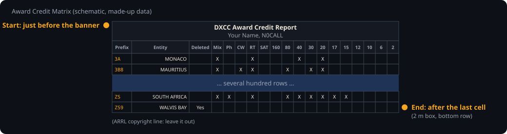
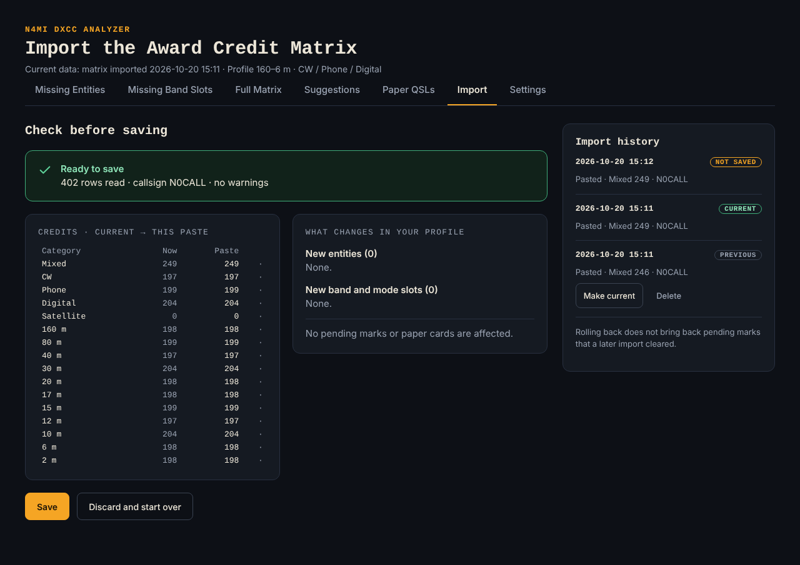
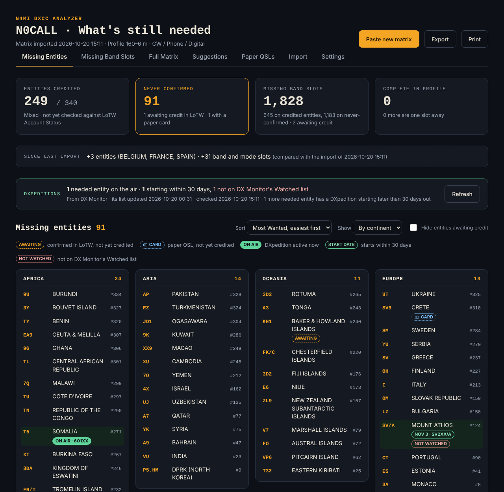
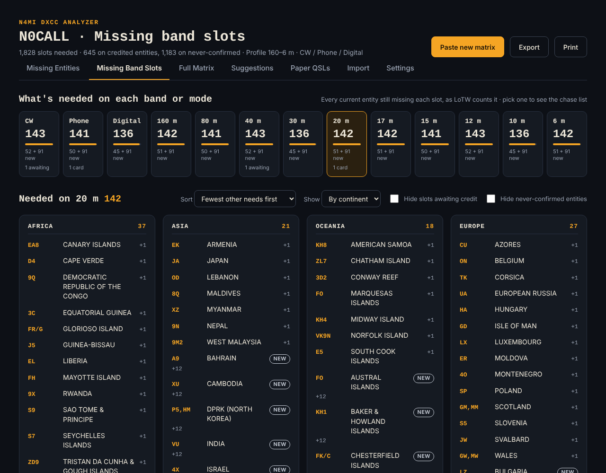
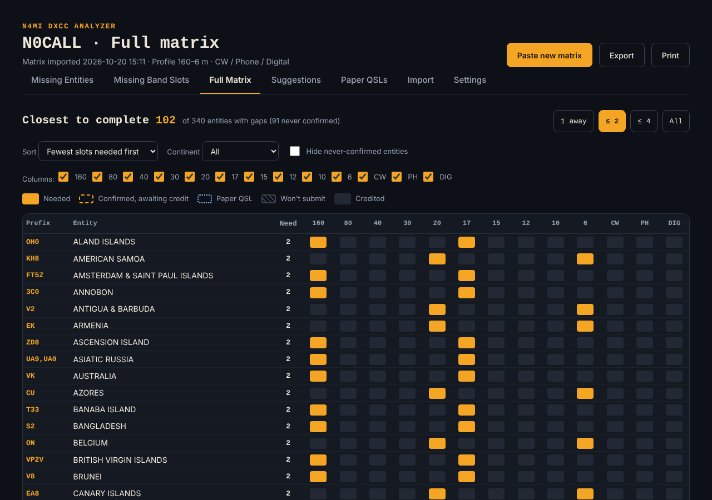
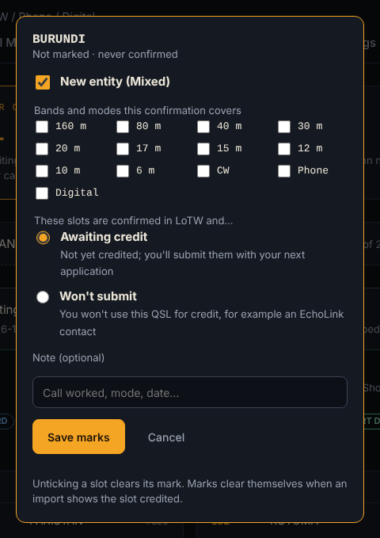
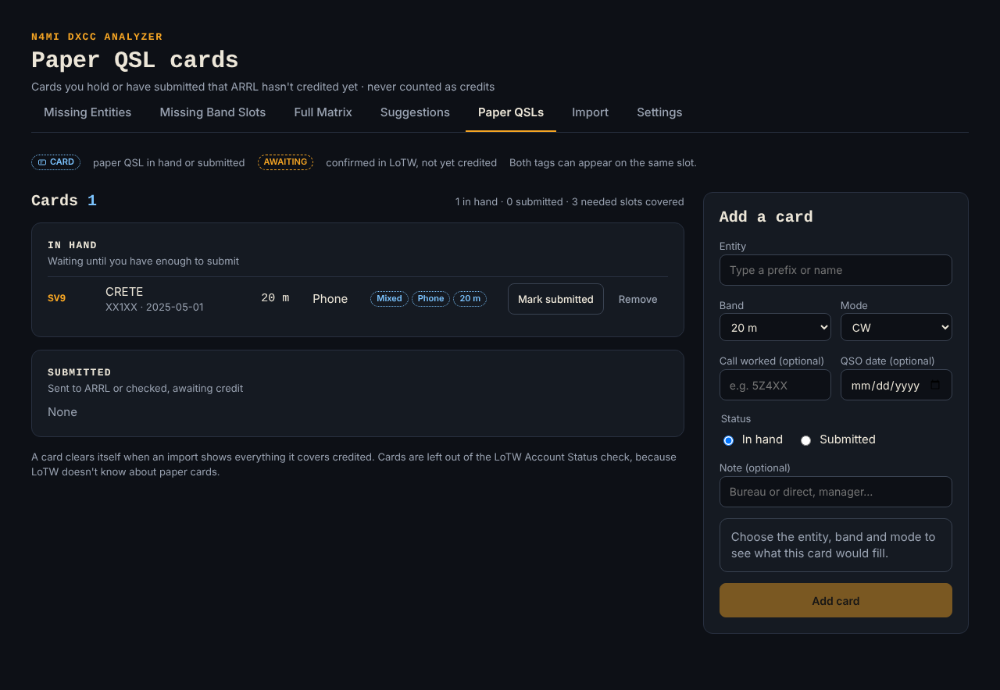
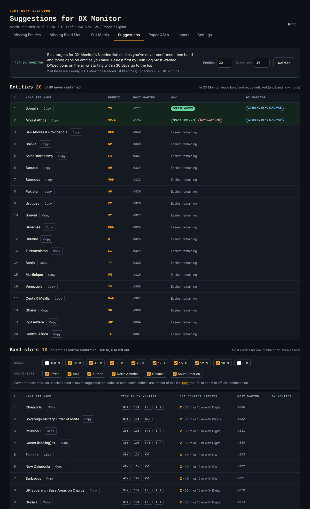
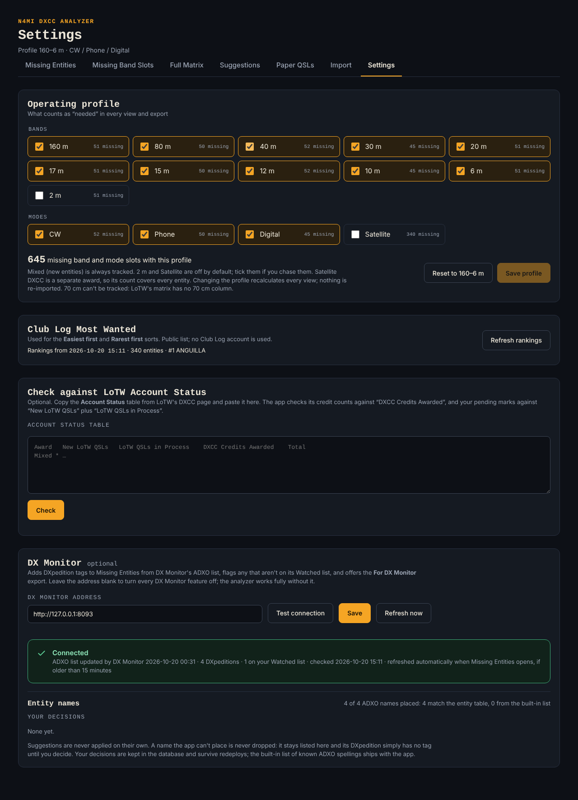
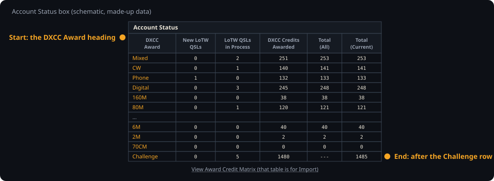

# N4MI DXCC Analyzer User Guide

This guide explains what the analyzer does and how to use it once it's running. For installation and deployment, see the [README](README.md).

The screenshots use made-up data for a test callsign, N0CALL, so the numbers in them don't belong to any real station.

In the app, this guide is the **Help** page. The **Help** link at the top of every page opens it at that page's section, and the version you're running is shown beside the app's name.

## Contents

- [The big picture](#the-big-picture)
- [Getting your LoTW data in (Import)](#getting-your-lotw-data-in-import)
  - [Copying the matrix from LoTW](#copying-the-matrix-from-lotw)
  - [Pasting it in](#pasting-it-in)
- [Missing Entities](#missing-entities)
- [Missing Band Slots](#missing-band-slots)
- [Full Matrix](#full-matrix)
- [Marking confirmations that aren't credited yet](#marking-confirmations-that-arent-credited-yet)
- [Paper QSLs](#paper-qsls)
- [Suggestions for DX Monitor](#suggestions-for-dx-monitor)
- [Settings](#settings)
  - [Checking against LoTW Account Status](#checking-against-lotw-account-status)
- [Exports and printing](#exports-and-printing)
- [Using the analyzer with DX Monitor](#using-the-analyzer-with-dx-monitor)
- [Best practices](#best-practices)
  - [The LoTW update cycle](#the-lotw-update-cycle)
  - [Keeping the analyzer and DX Monitor aligned](#keeping-the-analyzer-and-dx-monitor-aligned)
  - [Troubleshooting](#troubleshooting)

## The big picture

The analyzer answers one question at a glance: **what do I still need for DXCC on the bands and modes I actually work?**

A few rules shape everything it shows.

- **ARRL credit is the authority.** Your data comes from the LoTW **Award Credit Matrix** ("DXCC Credits Awarded"). It's the only source that includes paper-card credits, and the analyzer's counts match LoTW's Account Status table exactly.
- **Confirmations aren't credits.** A QSL that's confirmed in LoTW but not yet credited, or a paper card you haven't submitted, is shown with its own tag. It's never counted as a credit.
- **Bands and modes are credited separately.** One contact counts toward its band and its mode, plus Mixed if the entity is new. There are no band-and-mode combinations such as "17 m CW" in DXCC, so the analyzer never counts them.
- **Your operating profile decides what "needed" means.** It defaults to 160–6 m with CW, Phone and Digital, and you can change it in Settings. 2 m and Satellite are available but off by default. Satellite DXCC is a separate award, so a satellite contact counts toward Satellite only.
- **Deleted entities are left out.** Entities are keyed on their ARRL DXCC number, so spelling differences between LoTW, ADIF, Club Log and HamAlert never cause a mix-up.

The analyzer runs on your own network, with no login and no account anywhere. It never logs in to LoTW: you copy the matrix from LoTW yourself and paste it in.

## Getting your LoTW data in (Import)

<strong>Two LoTW tables, two places</strong>

LoTW's DXCC Award Account page has two tables that are easy to mix up:

- **Award Credit Matrix** (the long list, one row per entity) goes into **Import**. This is how your credits get into the analyzer.
- **Account Status** (the short box of counts at the top of the page) goes into **Settings → Check against LoTW Account Status**. It's an optional cross-check; see [Checking against LoTW Account Status](#checking-against-lotw-account-status).

Paste one in the other's place and the analyzer tells you which page it belongs on.

### Copying the matrix from LoTW

1. Log in to LoTW and open the **Awards** tab.
2. Choose **DXCC Award Account**.
3. Under the **Account Status** box, click **View Award Credit Matrix**. The link appears only for **DXCC Credits Awarded**, not for "New LoTW QSLs" or "LoTW QSLs in Process".
4. Click **No Scroll**, so the whole table is on one long page.
5. Select **everything from the "DXCC Award Credit Report" banner down to the last cell of the table**. The banner is the title line, with your name and callsign just below it; the last cell is the 2 m box of the bottom row (ZS9, Walvis Bay). An easy way: click just before the banner, scroll to the bottom, then hold **Shift** and click just after the last cell.
6. Copy (**Ctrl+C**).

Extra text above the banner does no harm. Stop at the last cell, though: if the ARRL copyright line under the table comes along, the check rejects the paste and says so. Copy again, or delete that line from the box.

### Pasting it in

1. In the analyzer, open **Import** (or press **Paste new matrix** on any list page), paste into the box, and press **Check paste**.
2. Read the check, then press **Save**. The check shows:
   - each category's credits now and in this paste
   - the new entities and band or mode slots this import adds
   - any pending marks or paper cards it will clear

**Optional: through a spreadsheet.** If you'd rather keep a copy, paste into cell **A1** of a new spreadsheet (Excel, LibreOffice Calc or Google Sheets), save it as `.xlsx` or `.csv`, and use **Upload a file**. A plain `.txt` file works too. Older `.xls` and `.ods` files aren't accepted.

Nothing is saved until you press Save. There are three possible outcomes:

- **Ready to save:** everything is consistent.
- **Held for review:** some credit would go *down*, which shouldn't normally happen. Check LoTW, tick **I checked LoTW, and this drop is real**, then **Save anyway**, or discard the paste.
- **Rejected:** the paste is incomplete or damaged. For example, a column is missing, a row is misaligned, an entity name is unknown, or the paste was cut off. The message names the line, and nothing is changed.

**Import history** keeps every saved import. **Make current** rolls back to an earlier one, and **Delete** removes one you don't need. Rolling back doesn't bring back pending marks that a later import cleared.

The paste itself isn't stored. Only the credits are kept, and the callsign from the paste's "Name, Callsign" line.

## Missing Entities

The main view: every current entity you've never had credited, grouped by continent or shown as one list.

- **Summary tiles:**
  - entities credited
  - entities never confirmed
  - missing band slots, split into slots on entities you've already credited and slots on never-confirmed ones
  - how many entities are complete, or one slot away, in your profile
- **Since last import:** what the latest import added, compared with the one before it.
- **Sort:**
  - **Most Wanted, easiest first** (the default) or rarest first, using Club Log's public Most Wanted ranking
  - **Entity name** or **Prefix**
  - **DXpeditions first**, when DX Monitor is connected
- **Hide entities awaiting credit:** shows only what you still have to work.
- **Tags:**
  - **AWAITING:** confirmed in LoTW, not yet credited
  - **CARD:** a paper QSL you hold or have submitted
  - **ON AIR**, a start date, and **NOT WATCHED:** DXpedition tags, when DX Monitor is connected (see below)

**Select any entity** to open its mark menu (see [Marking confirmations](#marking-confirmations-that-arent-credited-yet)).

## Missing Band Slots

One tile per band and mode in your profile, showing how many current entities still need it. Each tile matches LoTW's own count: current entities minus DXCC Credits Awarded. A tile like "51 + 91 new" splits that into entities you've credited and never-confirmed ones.

**Pick a tile** to see its chase list: every entity still needing that band or mode. It's the list to work from when a band opens. You can:

- **Sort** by fewest other needs first (entities this band would nearly complete), by Most Wanted, or by name.
- **Hide slots awaiting credit** or **hide never-confirmed entities**. Never-confirmed entities are tagged **NEW**, and "+N" shows how many other slots each entity needs.

The page also lists your pending marks, so you can see everything waiting for credit in one place.

## Full Matrix

Every entity with a gap in your profile, one column per band and mode:

| Cell | Meaning |
|---|---|
| Solid amber | Needed |
| Dashed amber outline | Confirmed in LoTW, awaiting credit |
| Dotted blue outline | Paper QSL |
| Hatched | Won't submit |
| Dark | Credited |

- **1 away, ≤ 2, ≤ 4, All** filters by how many slots each entity still needs. **1 away** is a quick list of entities you could complete with one more contact.
- **Sort, Continent, Hide never-confirmed entities** and the **column tickboxes** narrow the view.
- **Select a needed cell** to open the mark menu for that entity.

Filters on this page only change what you see. Your operating profile still decides what counts as needed.

## Marking confirmations that aren't credited yet

When LoTW confirms a QSO that ARRL hasn't credited yet, mark it, so the analyzer can tell you what's already on its way. Select an entity on any list page, or a cell in the Full Matrix:

1. Tick every slot the confirmation covers. One contact covers its band and its mode, plus **New entity (Mixed)** for a never-confirmed entity. The slot you clicked is ticked already, and credited slots are greyed out.
2. Choose **Awaiting credit** (you'll submit it) or **Won't submit** (you won't use it, for example an EchoLink contact).
3. Optionally add a note, then **Save marks**.

Unticking a slot clears its mark, and **Clear all** clears them all. Marks clear themselves when an import shows the slot credited, so importing the matrix is the normal way they get "checked off".

A **won't-submit** slot still counts as needed. That confirmation will never be credited, so you still need a new contact.

## Paper QSLs

Track paper QSL cards you hold or have sent to ARRL, so they show up beside your LoTW data.

1. In **Add a card**, choose the entity (type a prefix or name), the band, and the mode category (CW, Phone, Digital or Satellite). Call worked, QSO date and note are optional.
2. The box under the form shows what the card would fill, for example "Mixed · Phone · 20 m". A card that wouldn't add any credit is refused. A Satellite card has no band, because Satellite DXCC is separate.
3. **Add card.** It appears under **In hand**. Press **Mark submitted** once it's gone to ARRL or a card checker.

Cards show the **CARD** tag in every view. They're never counted as credits and are left out of the LoTW Account Status check, because LoTW doesn't know about paper cards. A card clears itself when an import shows everything it covers credited.

## Suggestions for DX Monitor

A ranked list of the best targets for DX Monitor's Needed list, with the exact names and settings to enter there. It's useful even without DX Monitor, as a short "what to chase next" list for any alert setup.

- **Entities:** your never-confirmed entities. DXpeditions on the air or starting within 30 days come first, then Club Log Most Wanted, easiest first.
- **Band slots:** one suggestion per entity you've already credited that still needs a band or mode.
  - **Ranking:** entities where one contact would earn **2** credits (a needed band *and* a needed mode) come first, then easiest first.
  - **Tick in DX Monitor:** shows exactly what to tick. Phone is SSB, and Digital is FT8 and FT4.
- **Counts:** set how many of each to show (20 entities and 10 band slots fill DX Monitor's 30 Needed entries).
- **Filters:** band and continent tickboxes narrow the band-slot list. They're saved for next time; **Reset** returns to the default (160 m and 6 m off, all continents on). Some uses:
  - untick 12 m and 10 m near solar minimum
  - untick a continent your antenna can't reach on the low bands
  - in a 6 m season, tick only 6 m and the continents the openings reach
- **What's left out:** anything awaiting credit or covered by a paper card. Won't-submit slots stay in.
- **Names are HamAlert's spellings.** Use **Copy** and paste them exactly. See [Using the analyzer with DX Monitor](#using-the-analyzer-with-dx-monitor) for why that matters.

## Settings

- **Operating profile:** tick the bands and modes you chase; each box shows how many entities still need it. **Save profile** recalculates every view; nothing is re-imported. **Reset to 160–6 m** restores the default. Mixed is always tracked. 70 cm can't be tracked, because LoTW's matrix has no 70 cm column.
- **Club Log Most Wanted:** **Refresh rankings** fetches Club Log's public list (no account needed) for the easiest-first and rarest-first sorts. It's only fetched when you press the button. If a fetch fails, the previous list is kept.
- **Check against LoTW Account Status:** optional. Proves the analyzer's counts agree with LoTW; see the next section.
- **DX Monitor:** optional. See the next sections.

### Checking against LoTW Account Status

Optional, but the quickest way to prove the analyzer agrees with LoTW. Use an Account Status table from the **same day** as your last import.

1. In LoTW, open **Awards → DXCC Award Account**.
2. In the **Account Status** box at the top, select from the **DXCC Award** column heading down to the **Challenge** row, the last row of the box. Don't click View Award Credit Matrix; that table is for Import.
3. Copy (**Ctrl+C**), then in the analyzer open **Settings → Check against LoTW Account Status**, paste, and press **Check**.

Reading the result:

- **Credits:** every category should match "DXCC Credits Awarded". A mismatch is a real problem, not rounding. First import a fresh matrix from the same day and check again; if it still disagrees, report it.
- **Pending marks:** your Awaiting and Won't-submit marks are compared with LoTW's "New LoTW QSLs" plus "LoTW QSLs in Process". A difference usually means a mark to add or remove. This comparison updates as you change marks, without running the check again.
- 70 cm and Challenge are listed but not checked, because the matrix has no 70 cm column.

## Exports and printing

**Export** (on the list pages) offers:

| File | What's in it |
|---|---|
| Workbook (`.xlsx`) | Summary, missing entities, missing slots, by band, the full matrix, pending marks, paper QSLs |
| `missing_entities.csv` | Never-confirmed entities with Most Wanted rank, marks and paper cards |
| `missing_slots.csv` | One column per band and mode in your profile; never-confirmed entities flagged in the last column |
| For DX Monitor: `no_confirms.csv` | Shown only when DX Monitor is connected; see below |

Exports always follow your operating profile, never a page's temporary filters. **Print** on each page gives a clean printout. Missing Entities, Missing Band Slots and Suggestions each fit on about one to two pages.

## Using the analyzer with DX Monitor

[DX Monitor](https://github.com/N4MI73/n4mi-dx-monitor) is a separate project: a desk instrument and web display that alerts you when a station or entity you care about is spotted, using HamAlert. The two apps split the work:

- **The analyzer knows what you still need.**
- **DX Monitor knows what's on the air right now, and alerts you.**

Neither depends on the other. Each keeps working if the other is down, and the analyzer works fully for anyone who doesn't run DX Monitor.

### Connecting them

1. In **Settings → DX Monitor**, enter DX Monitor's address, for example `http://192.168.6.29:8083`.
2. Press **Test connection**. It reports how many DXpeditions DX Monitor knows, how many are on your Watched list, and how many entries are in its Needed list. Nothing is saved yet.
3. Press **Save**.

To switch every DX Monitor feature off again, clear the address and Save.

The analyzer only ever **reads** from DX Monitor. It reads three lists: DXpeditions (`/api/adxo`), Watched (`/api/watched`) and Needed (`/api/needed`). Reads happen when Missing Entities or Suggestions opens, if the last check was 15 minutes ago or more, or when you press **Refresh**. It never adds, removes or changes anything in DX Monitor; your lists there stay yours to curate.

### What you get

**DXpedition tags on Missing Entities**

- **ON AIR · call:** a needed entity with a DXpedition on the air now.
- **NOV 3 · call:** a DXpedition starting within 30 days.
- **NOT WATCHED:** the DXpedition isn't on DX Monitor's Watched list. It's a nudge to add it there and set up its HamAlert trigger.
- The DXpeditions strip sums these up. The **DXpeditions first** sort puts them at the top.
- If DX Monitor doesn't answer, the last list received stays on screen with its time.
- **Settings → Entity names:** ADXO names entities in its own spelling, and the analyzer places almost all of them automatically. Any name it can't place is listed there with a suggested entity. You **Approve suggestion**, **Or choose** another, or **Ignore** it; nothing is applied without you.

**ALREADY IN DX MONITOR tags on Suggestions**

- **Entity suggestions:** tagged when DX Monitor's Needed list has a whole-entity entry for that entity.
- **Band-slot suggestions:** tagged when an entry would catch the same spots.
- **Misspelled entries:** the strip also lists any Needed entry whose name matches no HamAlert entity. Such an entry would never get a hit, so it's worth fixing.

**The `no_confirms.csv` export**

DX Monitor's Trigger Builder uses this file as its entity picker. DX Monitor builds the file into its image, so loading a new one takes three steps:

1. Export it from the analyzer.
2. Replace `server/no_confirms.csv` in the DX Monitor repository, commit and push.
3. **Pull and redeploy** the `dxmon` stack in Portainer.

Repeat after each LoTW update that credits new entities.

### Turning suggestions into DX Monitor entries and HamAlert triggers

For each suggestion you want to chase:

1. **Copy** the HamAlert name from Suggestions.
2. In DX Monitor's **Needed** page, paste the name.
   - For an **entity**, leave band and mode unticked.
   - For a **band slot**, tick exactly the bands and modes in the **Tick in DX Monitor** column.
3. Build the matching **HamAlert trigger** (DX Monitor's Trigger Builder helps) with the identical entity, bands and modes.
4. Back in the analyzer, press **Refresh** on Suggestions. The entry now shows **ALREADY IN DX MONITOR**.

**Why the spelling matters:** DX Monitor matches HamAlert spots by HamAlert's entity name, ignoring only capitals and spaces at the start or end. A doubled space inside a name counts as a different spelling.

- **A different spelling never matches.** LoTW's "U K BASES ON CYPRUS" won't match HamAlert's "UK Sovereign Base Areas on Cyprus", so an entry spelled that way never shows a hit.
- **Where the analyzer's names come from:** HamAlert takes its entity data from Club Log, which uses the standard ADIF names, and the analyzer shows exactly those.
- **Two exceptions:** HamAlert still lists two renamed entities under their old names, **Swaziland** (Eswatini) and **Macedonia** (North Macedonia). The analyzer knows about both.

**Why "2 credits" comes first:** a band-slot suggestion such as "40m, 12m with CW" means every spot DX Monitor alerts on is a contact worth two credits, one band plus one mode. A suggestion with only bands (any mode) or only modes (any band) is worth one.

## Best practices

### The LoTW update cycle

1. As LoTW confirms contacts, **mark** them Awaiting credit, so the analyzer and Suggestions stop treating them as needed.
2. Optionally run the **Account Status check** in Settings. Your marks should match LoTW's pending numbers.
3. When you submit an application to ARRL and the credits are granted, copy the new **Award Credit Matrix** and **Import** it.
4. Check **Since last import**. The credited slots' marks clear by themselves, and any paper cards now fully credited clear too.
5. If you run DX Monitor, export `no_confirms.csv` and load it there. Remove Needed entries and HamAlert triggers for anything newly credited; Suggestions will stop suggesting them.

### Keeping the analyzer and DX Monitor aligned

- **Use Suggestions as the starting point** when you have free Needed entries, after an import, at a change of season, or when a band opens.
- **Watch the NOT WATCHED tag** on Missing Entities. It's how a DXpedition you haven't set up yet gets noticed.
- **Use the filters for real conditions,** not just preference: 12 m and 10 m near solar minimum, 6 m only in season, or a continent your antenna can't reach.
- **Act on any misspelled-entry warning** on Suggestions. It points at a Needed entry that can never fire.
- **Keep things one-to-one.** As in DX Monitor's own guide: every Needed entry should have a matching HamAlert trigger, and every trigger a purpose.

### Troubleshooting

| Symptom | First things to check |
|---|---|
| An import is rejected | The paste is incomplete: copy the whole matrix table from LoTW again, from the banner to the last cell. The message names the line |
| Import says it's the Account Status table | You copied the summary box. Click **View Award Credit Matrix** and copy that table instead; the Account Status table goes in Settings |
| An import is held for review | A credit would go down. Check LoTW; save anyway only if the drop is real |
| Counts don't match LoTW's Account Status | Run the check in Settings with a same-day Account Status table. A mismatch is a defect worth reporting |
| The Settings pending check shows a mismatch | A confirmation is missing a mark, or a mark has no matching confirmation; the line says which |
| No Most Wanted ranks; lists are in name order | Press **Refresh rankings** in Settings |
| No DXpedition tags | DX Monitor's address isn't set, or it isn't answering (the strip says so). Or no needed entity has a DXpedition within 30 days |
| A DXpedition isn't tagged | Its ADXO name may be waiting for your OK in **Settings → Entity names** |
| Suggestions shows no ALREADY IN DX MONITOR tags | DX Monitor isn't connected, or its Needed list couldn't be read (the strip says which). An older DX Monitor without `/api/needed` simply gives no tags |
| A DX Monitor Needed entry never gets a hit | Check its spelling against the HamAlert name in Suggestions, and that a matching HamAlert trigger exists |
| Every page shows a "Problem" banner | The database or the data folder isn't readable; see the README's deployment section |
| Which version am I running? | It's beside the app's name at the top of every page |
